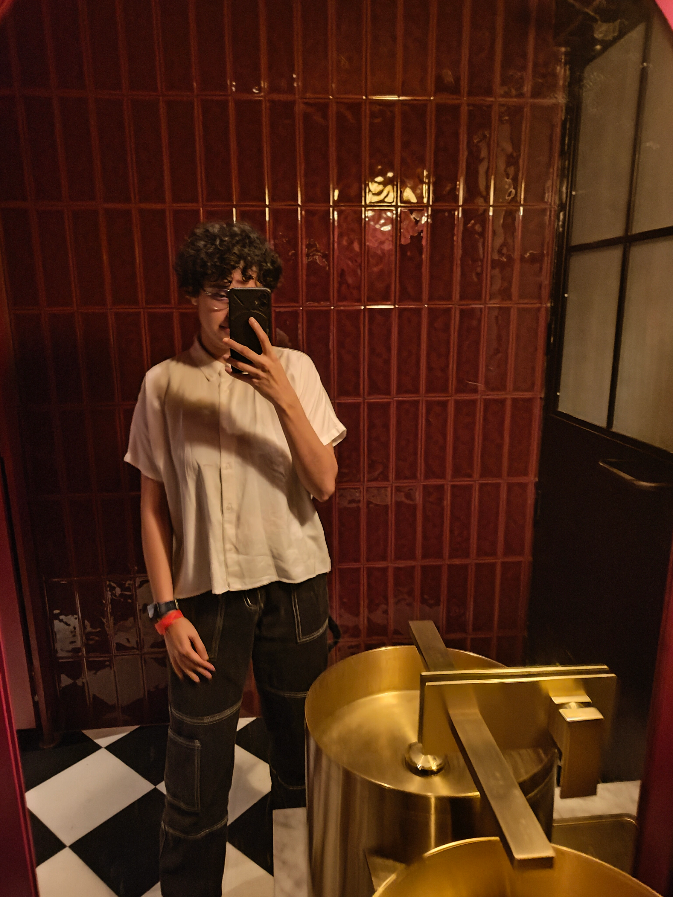
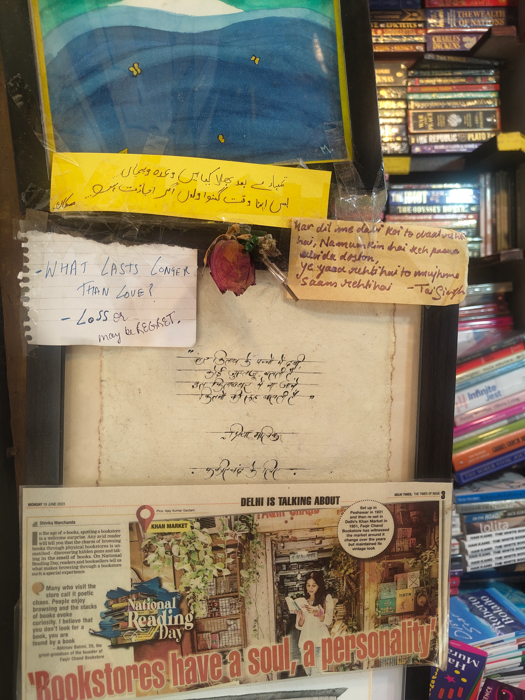
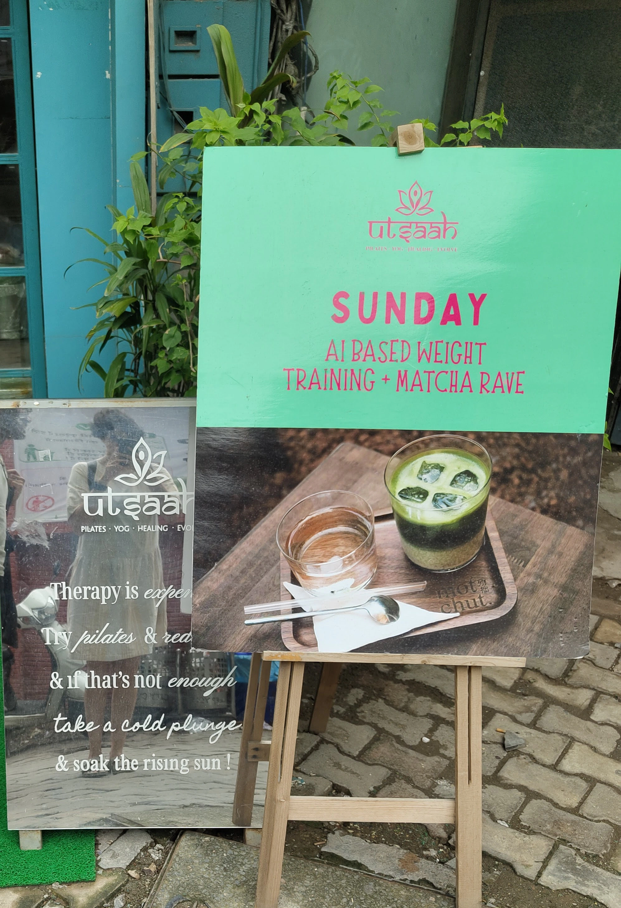

import ArrowLink from "../components/ArrowLink.astro";
import AudioPlayer from "../components/AudioPlayer.astro";
import FeedbackMessage from "../components/FeedbackMessage.astro";
import Note from "../components/Note.astro";
import NoteFocusLine from "../components/NoteFocusLine.astro";
import NoteSpine from "../components/NoteSpine.astro";
import SectionFooter from "../components/SectionFooter.astro";
import ColourInventory from "./ColourInventory.astro";

Every component and markdown feature built for this site, in each of its variants. Before building something new, check here for something to reuse. When you add a component or plugin, add it here too: `tests/components-page.test.ts` fails until you do.

To check a change, load this page at 375, 768 and 1280px wide. The colours at the bottom list every colour in use, with its contrast against the page.

<TableOfContents />

## Links

### ArrowLink

`src/components/ArrowLink.astro`. Directional navigation: an arrow glued to a label, coloured at rest and underlined on hover. With a `title`, the label becomes a caption over the destination.

```astro
<ArrowLink href="/tags" label="all tags" />
<ArrowLink
  href="/blog/dramione"
  label="next"
  title="Dramione"
  direction="forward"
/>
```

#### Back, no title

<ArrowLink href="/tags" label="all tags" />

#### Forward, no title

<ArrowLink href="/tags" label="all tags" direction="forward" />

#### Back, with title

<ArrowLink
  href="/blog/define-partner"
  label="previous"
  title="Define partner"
/>

#### Forward, with title

<ArrowLink
  href="/blog/dramione"
  label="next"
  title="Dramione"
  direction="forward"
/>

### External links

`src/plugins/rehype-external-links.mjs`. Any off-site link in markdown opens in a new tab and gets an icon saying so. On-site links stay plain.

```md
[Astro's docs](https://docs.astro.build) and [my tags](/tags)
```

[Astro's docs](https://docs.astro.build) and [my tags](/tags).

### Heading and paragraph anchors

`rehype-autolink-headings` (configured in `astro.config.mjs`) and `src/plugins/rehype-anchors.mjs`. Every heading below h1 gets a trailing `#` link; every paragraph and list item gets a `#` link on hover. Poetry and notes skip paragraph anchors; a post can opt out with `anchors: false`.

Hover this paragraph to see its anchor.

- And this list item.

## Table of contents

`src/components/TableOfContents.astro`. An MDX post writes `<TableOfContents />` where the inline copy goes. EntryPage adds the margin copy, which shows from the `xl` breakpoint up, sticks to the top, fades while scrolling down and marks the section being read.

```mdx
<TableOfContents />
```

#### Inline (below xl)

The inline copy sits at the top of this page. Below `xl` it shows there; from `xl` up it is hidden and the margin copy shows in the right margin instead.

## Notes

### Note

`src/components/Note.astro`. A note in feed style: its content, then a small-caps footer with the timestamp, tags, any extra `meta` slot items, and a permalink.

```astro
<Note publishedOn={date} href="/2026aug20-01" tags={["philosophy"]}>
  <p>Note text.</p>
  <span slot="meta">3 of 11</span>
</Note>
```

#### Timestamp only

<Note publishedOn={new Date("2026-08-20T21:27:00+05:30")}>
  <p>Landed in Delhi. The air smells like a bonfire.</p>
</Note>

#### With permalink and tags

<Note
  publishedOn={new Date("2026-08-20T21:27:00+05:30")}
  href="/2026aug20-01"
  tags={["philosophy", "reviews"]}
>
  <p>Landed in Delhi. The air smells like a bonfire.</p>
</Note>

#### With a meta slot item

<Note publishedOn={new Date("2026-08-20T21:27:00+05:30")} href="/2026aug20-01">
  <p>Landed in Delhi. The air smells like a bonfire.</p>
  <span slot="meta">3 of 11</span>
</Note>

### NoteEmbed

`src/components/NoteEmbed.astro`, placed by `src/plugins/remark-note-embeds.mjs`. In an MDX post, a note's URL alone on its line becomes the note itself, quoted. A missing note fails the build.

```mdx
https://tanvibhakta.in/2026aug20-01
```

https://tanvibhakta.in/2026aug20-01

### NoteSpine

`src/components/NoteSpine.astro`. A thread note's line in the feed's left margin. Each end is `"solid"` (joins a neighbouring thread note), `"stub"` (a dashed tail: the thread continues further away) or `null` (the thread starts or ends here). Place it inside a `relative py-4` wrapper.

```astro
<div class="relative py-4">
  <NoteSpine up={null} down="solid" />
  …note…
</div>
```

#### First note: up null, down solid

<div class="relative py-4">
  <NoteSpine up={null} down="solid" />
  The first note of a thread.
</div>

#### Middle note: up solid, down solid

<div class="relative py-4">
  <NoteSpine up="solid" down="solid" />A reply, with another reply below it.
</div>

#### Latest note: up solid, down null

<div class="relative py-4">
  <NoteSpine up="solid" down={null} />
  The latest note in the thread.
</div>

#### Continues elsewhere: up stub, down stub

<div class="relative py-4">
  <NoteSpine up="stub" down="stub" />A thread note whose neighbours are further
  away in the feed.
</div>

### NoteFocusLine

`src/components/NoteFocusLine.astro`. Replaces NoteSpine beside the note a page is about: the line thickens and darkens beside it. `joinsUp` and `joinsDown` say whether it meets a neighbour's line.

```astro
<div class="relative">
  <NoteFocusLine joinsUp={true} joinsDown={false} />
  …note…
</div>
```

#### Joins neither

<div class="relative ml-12 py-6">
  <NoteFocusLine joinsUp={false} joinsDown={false} />A note on its own page,
  with no thread around it.
</div>

#### Joins up

<div class="relative ml-12 py-6">
  <NoteFocusLine joinsUp={true} joinsDown={false} />A reply: its parent is
  above.
</div>

#### Joins down

<div class="relative ml-12 py-6">
  <NoteFocusLine joinsUp={false} joinsDown={true} />A thread's first note: a
  reply is below.
</div>

#### Joins both

<div class="relative ml-12 py-6">
  <NoteFocusLine joinsUp={true} joinsDown={true} />
  The middle of a thread.
</div>

## Navigation

### SectionFooter

`src/components/SectionFooter.astro`. Previous and next posts in a section, at the bottom of every post (ProseLayout renders it from `sectionNav`). Built from two ArrowLinks; renders nothing with neither.

```astro
<SectionFooter noun="post" prev={{ href, title }} next={{ href, title }} />
```

#### Both

<SectionFooter
  noun="post"
  prev={{ href: "/blog/define-partner", title: "Define partner" }}
  next={{ href: "/blog/dramione", title: "Dramione" }}
/>

#### Previous only (the latest post)

<SectionFooter
  noun="post"
  prev={{ href: "/blog/define-partner", title: "Define partner" }}
/>

#### Next only (the first post)

<SectionFooter
  noun="post"
  next={{ href: "/blog/dramione", title: "Dramione" }}
/>

## Media

### Galleries

`src/plugins/rehype-gallery.mjs`. Adjacent image lines, or image-only paragraphs separated by blank lines, group into one `<figure class="gallery">`. Any prose in between breaks the group. An image's title is its caption.

```md


```

#### One image, with caption


#### One image, no caption



#### Two images, one captioned

 in the Purana Qila complex")


#### Three or more images, mixed captions





### Lightbox viewer

`src/components/Lightbox.astro`, in the base Layout. Click or press Enter on any image above to open it full-screen; swipe or use the arrow keys between images, and Escape, back or a tap closes it. Each slide shows its image's caption.

### AudioPlayer

`src/components/AudioPlayer.astro`. A waveform player; EntryPage adds it when a post's frontmatter has `audio`. Falls back to the browser's own controls if the waveform fails to load.

```astro
<AudioPlayer
  src="/media/audio/define-partner.oga"
  title="Listen to this blog"
/>
```

<AudioPlayer
  src="/media/audio/define-partner.oga"
  title="Listen to this blog"
/>

## Feedback

### FeedbackMessage

`src/components/FeedbackMessage.astro`. A small grey status line, announced to screen readers (`aria-live="polite"`). Hidden until a script removes `hidden`.

```astro
<FeedbackMessage id="copy-status">Link copied</FeedbackMessage>
```

#### Shown

<FeedbackMessage class="inline!">Link copied</FeedbackMessage>

## Prose defaults

The typography plugin's styles plus `src/styles/global.css`, for anything written in markdown.

### Heading three

#### Heading four

A paragraph with a [link](/tags), **bold**, _italic_ and `inline code`.

> A blockquote, for quoting someone else.

1. An ordered list
2. with two items

- An unordered list
- with two items

| Place       | What we ate   |
| ----------- | ------------- |
| Khan Market | Faqir Chand's |
| Purana Qila | nothing       |

```js
const codeBlock = "syntax highlighted";
```

---

## Colours

`src/utils/colour-inventory.ts` scans `src/` when the site builds, so this list is always current. It is also the dark-mode to-do list: each colour needs a dark counterpart or a theme token.

<ColourInventory />
